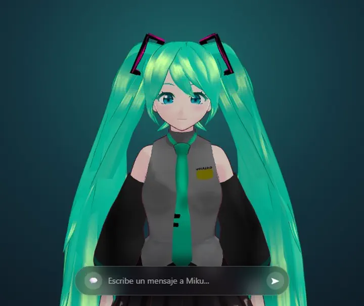
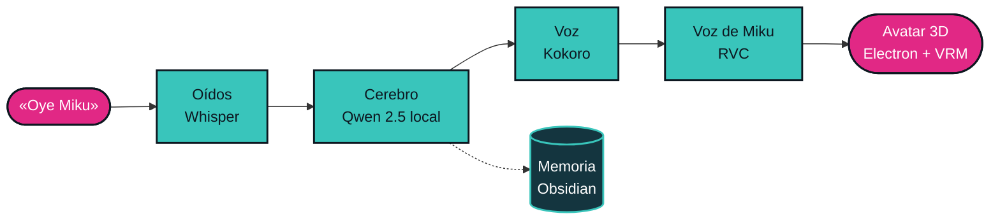

<h1>Miku IA</h1>

<b>«Oye Miku».</b> 
Un asistente de voz tipo Alexa con Hatsune Miku que vive en tu escritorio y funciona sin internet.

  

 

> La llamas, te escucha, te contesta con su voz y aparece en una esquina de la pantalla. Todo corre en tu propia computadora: nada sale a internet.

 

## ✦ Cómo piensa

 

## ✦ Lo que hace

<table>
  <tr>
    <td width="50%" valign="top"><b>Te escucha</b> Se activa con «Oye Miku» y entiende lo que le dices, sin conexión.</td>
    <td width="50%" valign="top"><b>Contesta rápido</b> Empieza a hablar en cuanto tiene la primera oración, mientras piensa la siguiente.</td>
  </tr>
  <tr>
    <td valign="top"><b>Con su propia voz</b> Kokoro genera la voz y RVC la convierte en la de Miku.</td>
    <td valign="top"><b>Vive en tu escritorio</b> Un avatar 3D que parpadea, respira, te sigue con la mirada y mueve la boca al hablar.</td>
  </tr>
  <tr>
    <td valign="top"><b>Recuerda</b> Lleva un diario y guarda lo importante en su propia bóveda de Obsidian.</td>
    <td valign="top"><b>Se hace a un lado</b> «Miku duerme» o «modo juego» liberan la tarjeta de video para jugar.</td>
  </tr>
  <tr>
    <td colspan="2" valign="top"><b>También por texto</b> Una barra de chat para cuando no puedes hablar en voz alta.</td>
  </tr>
</table>

 

## ✦ Estado

En pausa. Funciona de principio a fin, pero ocupa de 10 a 14 GB de VRAM y le falta optimizarse.

 

---

Proyecto personal de <a href="https://carloramirez.dev"><b>Carlo Ramírez</b></a> · 2026 
Hatsune Miku es un personaje de Crypton Future Media. Este es un proyecto de fan sin fines comerciales.

